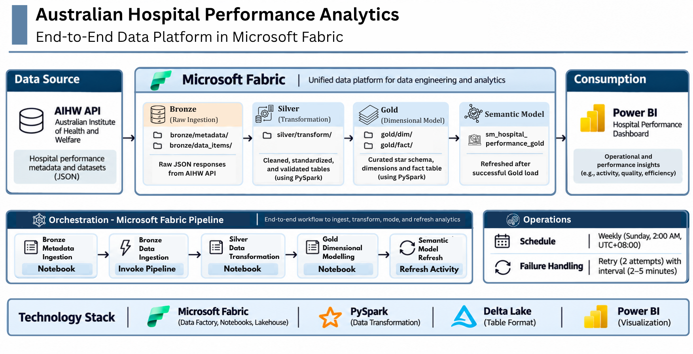
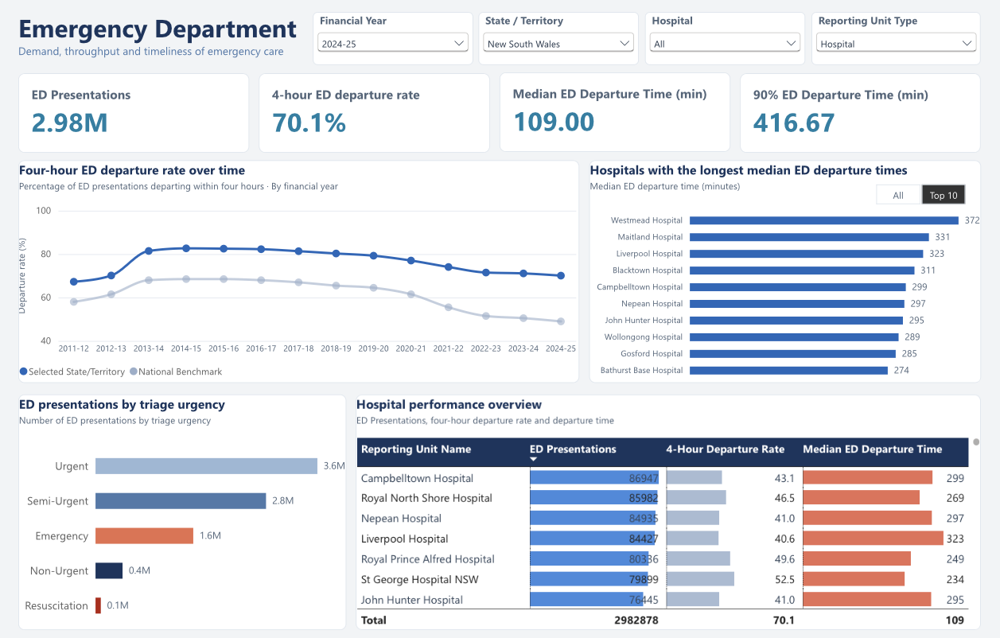
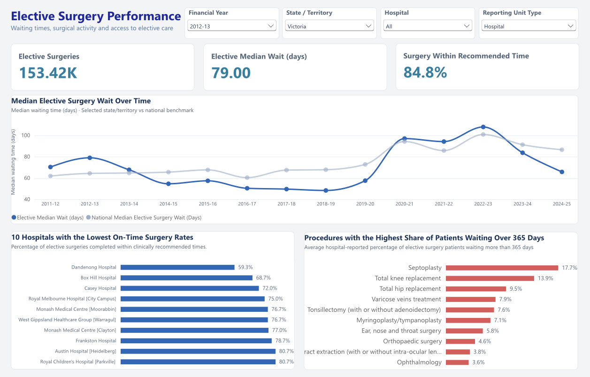

# Australian Hospital Performance Analytics

An end-to-end data engineering and analytics project built on Microsoft Fabric, using the AIHW MyHospitals API to analyse emergency department and elective surgery performance across Australian hospitals. The project implements a Bronze–Silver–Gold medallion architecture, from REST API ingestion and PySpark transformations to dimensional modelling, a semantic model, and interactive Power BI dashboards.

The workflow uses Microsoft Fabric Data Factory pipelines for ingestion and end-to-end orchestration, Fabric Lakehouse and Delta Lake for data storage, PySpark for data processing, and Power BI with DAX for reporting. A scheduled master pipeline coordinates the ingestion, transformation, Gold modelling, and semantic model refresh.

Developed through AI-assisted pair programming, with Claude (Anthropic) and ChatGPT (OpenAI) supporting implementation, troubleshooting, and technical reviews. The project concept, architecture, technology selections, data modelling approach, and final design decisions were my own. I used AI tools to accelerate development, explore solutions, and review code, while taking responsibility for understanding, testing, and validating each component of the implementation.

## Architecture



The workflow follows a Bronze–Silver–Gold structure:

- **Bronze:** retrieves hospital measure data and reference metadata from the AIHW MyHospitals API and stores the raw JSON responses in the Lakehouse.
- **Silver:** uses PySpark to parse and standardise the source data, retain relevant suppression and caveat details, and create structured observation and reference tables.
- **Gold:** builds a fact table and supporting dimensions for reporting. The model is designed to support comparisons across measures, hospitals and other reporting units, and reporting periods.

A master pipeline coordinates metadata ingestion, Bronze ingestion, Silver transformation, and Gold modelling. It then refreshes the semantic model. The pipeline is scheduled to run weekly on Sundays at 2:00 AM (UTC+8, Philippine time).

## Dashboards

### Emergency Department



The page covers ED presentations, four-hour departure rates, median and 90th-percentile departure times, triage distribution, and hospital-level comparisons.

### Elective Surgery Performance



The page looks at elective surgery volumes, waiting times, the share of patients treated within recommended timeframes, and patients waiting longer than 365 days. It also supports comparisons across hospitals and procedures.

## Data source

The project uses the [AIHW MyHospitals API](https://www.aihw.gov.au/hospitals/other-resources/myhospitals-api), specifically its version 1 endpoints for measure data and supporting metadata.

The ingestion workflow retrieves data for the selected hospital measure codes, along with metadata such as measures, categories, datasets, reporting units, and reporting-unit types. The API returns published hospital information in JSON, including observations at different reporting levels where available.

Source data and definitions can change as AIHW publishes updates. The pipeline is designed to retrieve the current API responses when it runs; the repository does not include a full copy of the raw data.

## Tools and technologies

- **Microsoft Fabric** – Lakehouse, notebooks, Data Factory pipelines, and semantic model
- **Python** – API requests and data exploration
- **PySpark** – data parsing, cleaning, transformation, and dimensional modelling
- **Delta tables** – structured Bronze, Silver, and Gold storage
- **Power BI / DAX** – semantic model measures and dashboards
- **AIHW MyHospitals API** – source data

## Data checks and modelling

The transformation notebooks include checks for source measure coverage, missing metadata matches, null values, suppression details, dimension lookups, orphan keys, and persisted row counts.

Suppressed or unavailable values are retained with their related source information rather than being treated as ordinary numeric observations. National reporting records and national benchmarks are also kept distinct from individual hospital records, so they are not accidentally treated as additional hospitals in hospital-level comparisons.

### Directory Overview

| Directory / File | Description |
|---|---|
| `docs/` | Architecture diagram and Power BI dashboard screenshots |
| `notebooks/` | API exploration, Bronze ingestion, Silver transformation, and Gold modelling notebooks |
| `pipelines/` | Exported Fabric pipeline definitions for ingestion and orchestration |
| `semantic_model/` | TMDL semantic model definition, relationships, tables, and DAX measures |
| `project_context.md` | Project background, business problem, objectives, and scope |
| `project_plan.md` | Development stages, implementation decisions, and future improvements |
| `.gitignore` | Excludes local environments, temporary files, and generated data from Git |

## Project Structure

```text
australian-hospital-performance-analytics/
│
├── docs/
│   ├── aihw_architecture.png
│   ├── emergency_department_dashboard.png
│   └── elective_surgery_dashboard.png
│
├── notebooks/
│   ├── README.md
│   ├── aihw_data_exploration.ipynb
│   ├── bronze_aihw_metadata_ingestion.ipynb
│   ├── silver_aihw_data_transformation.ipynb
│   └── gold_aihw_performance_model.ipynb
│
├── pipelines/
│   ├── README.md
│   ├── pl_aihw_bronze_ingestion.json
│   └── pl_aihw_master_orchestration.json
│
├── semantic_model/
│   ├── README.md
│   ├── .platform
│   ├── definition.pbism
│   └── definition/
│       ├── database.tmdl
│       ├── expressions.tmdl
│       ├── model.tmdl
│       ├── relationships.tmdl
│       └── tables/
│           ├── gold_dim_measure.tmdl
│           ├── gold_dim_period.tmdl
│           ├── gold_dim_reported_measure.tmdl
│           ├── gold_dim_reporting_unit.tmdl
│           ├── gold_fact_measure_value.tmdl
│           └── Hospital Display.tmdl
│
├── project_context.md
├── project_plan.md
├── README.md
└── .gitignore
```

## Running the project

The files in this repository are exports from a Microsoft Fabric workspace. They document the implementation, but some Fabric references are workspace-specific.

To run the workflow in another workspace, you will need to create or configure a Fabric workspace and Lakehouse, set up the required API and Fabric connections, update workspace and item references in the pipeline definitions, and then import and run the notebooks and pipelines in order. The semantic model will also need to be connected to the Gold tables in that workspace.

The AIHW API is publicly accessible, but the Fabric workspace, Lakehouse, pipeline connections, and semantic model are environment-specific.

## Development notes

This is an independent portfolio project built as a practical way to develop my experience with data engineering and analytics engineering workflows. I worked through the source API, ingestion design, transformations, dimensional model, semantic layer, and reporting, testing the pipeline in Fabric as I went.

AI tools were used as development support, not as a substitute for reviewing the implementation. I made the project and modelling decisions and checked the outputs against the source data and the intended reporting use.

---

*Data source: Australian Institute of Health and Welfare (AIHW), MyHospitals API. This is an independent project and is not an official AIHW product.*
